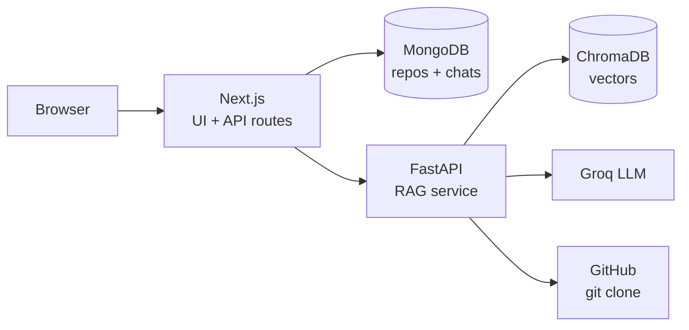

# CodeLens

**Chat with any public GitHub repository using RAG.** Paste a repo URL, let CodeLens index the code, then ask questions like *"What is the tech stack?"*, *"Where is authentication handled?"* or *"Explain the folder structure"*. Every answer comes with the files it was based on.


<!-- Replace with a real screenshot or GIF: put it in docs/ and keep the name, or change the path above -->

## Features

- **Add any public GitHub repo** by URL, indexed in the background with live status (`ingesting`, `ready`, `failed`)
- **Grounded answers with sources**: each reply lists the files and line numbers it used
- **Repository file tree awareness**: folder-structure questions are answered from a real file tree, not guesses
- **Chat history** saved per repository (MongoDB)
- **Markdown answers** with tables, lists and code blocks
- **Fast inference** through Groq

## Architecture



- **Next.js** serves the UI and the backend API (Route Handlers), stores repos and chat history in MongoDB, and talks to the Python service.
- **FastAPI** does the AI work: clones the repo, chunks the code, stores embeddings in ChromaDB, retrieves relevant chunks and asks the LLM.

## How the RAG pipeline works

**Ingest** (`POST /ingest`)
1. Shallow-clone the repository into a temp folder
2. Skip noise (`node_modules`, lock files, build output, huge files) and keep readable source/doc files
3. Split files into overlapping line-based chunks, each tagged with `file` and `start_line`
4. Build a compact **file tree** of the repo and store it as a special document
5. Store everything in a per-repo ChromaDB collection (embeddings are generated locally with Chroma's default MiniLM model)

**Query** (`POST /query`)
1. Embed the question and retrieve the most similar chunks
2. Always add the file tree and key manifest files (`package.json`, `requirements.txt`, `Dockerfile`, README, ...)
3. De-duplicate and fit everything into a context size budget
4. Send context + question to the LLM with a strict "answer only from context, say if not found" system prompt
5. Return the answer and its sources

## Tech stack

| Layer | Technology |
|---|---|
| Frontend + API | Next.js (App Router), React, Tailwind CSS |
| Database | MongoDB (Mongoose) |
| RAG service | Python, FastAPI, Uvicorn |
| Vector store | ChromaDB (persistent) |
| LLM | Groq API (model configurable) |
| Git handling | GitPython |

## Project structure

```
Code-Lens/
├── frontend/                 # Next.js app (UI + backend API)
│   └── src/
│       ├── app/
│       │   ├── page.js               # home: add repo, repo list
│       │   ├── repo/[id]/page.js     # chat UI
│       │   └── api/                  # route handlers
│       │       ├── health/
│       │       ├── repos/            # list, add, status
│       │       └── chat/             # ask, history
│       ├── lib/                      # db connection, python client, api helpers
│       └── models/                   # Mongoose models (Repo, Chat)
└── python-services/          # FastAPI RAG service
    └── app/main.py                   # /ingest, /query, /health
```

## Getting started

### Prerequisites
- Node.js 20+
- Python 3.12+
- Git (the Python service clones repos)
- MongoDB (local) or a free MongoDB Atlas cluster
- A Groq API key from [console.groq.com](https://console.groq.com)

### 1. Clone
```bash
git clone https://github.com/Muhammadsiddiqui07/Code_Lense.git
cd Code_Lense
```

### 2. Python service
```bash
cd python-services
python -m venv venv
# Windows: venv\Scripts\activate    |    macOS/Linux: source venv/bin/activate
python -m pip install -r requirements.txt
```
Create `python-services/.env` (see `.env.example`):
```env
GROQ_API_KEY=your_groq_key
GROQ_MODEL=your_groq_model_id
```
Run it:
```bash
python -m uvicorn app.main:app --port 8000
```
> The first `/ingest` downloads the embedding model (~80 MB). Let it finish before sending more requests.

### 3. Frontend
```bash
cd frontend
npm install
```
Create `frontend/.env.local` (see `.env.example`):
```env
MONGO_URI=mongodb://127.0.0.1:27017/codelens
PYTHON_URL=http://127.0.0.1:8000
```
Run it:
```bash
npm run dev
```
Open [http://localhost:3000](http://localhost:3000), add a repo URL, wait for status **ready**, then chat.

## API reference

**Next.js API** (`/api`)

| Method | Route | Description |
|---|---|---|
| GET | `/api/health` | Health check |
| GET | `/api/repos` | List repos with status |
| POST | `/api/repos` | Add a repo and start indexing (`202`) |
| GET | `/api/repos/:id` | Single repo status |
| POST | `/api/chat` | Ask a question `{ repoId, question }` |
| GET | `/api/chat/:repoId` | Chat history |

**Python service**

| Method | Route | Description |
|---|---|---|
| GET | `/health` | Health check |
| POST | `/ingest` | Clone, chunk and index a repo `{ repo_url }` |
| POST | `/query` | Retrieve and answer `{ repo_url, question }` |

## Challenges and what I learned

- **Folder-structure questions were guesses.** Similarity search returns code chunks, so the model never saw the repo layout and kept saying "likely" and "not shown". I fixed it by indexing a compact file tree as its own document and always adding it to the context.
- **Noisy files hurt retrieval.** Lock files like `package-lock.json` dominated the top results for generic questions. Skipping them and force-including manifest files improved tech-stack answers a lot.
- **Indexing is slow, so it can't block the request.** Ingest runs in the background; the API returns `202` immediately and the UI polls the repo status.
- **Context size matters.** I added a context budget, de-duplication and a tunable `top_k` to stay within LLM token limits without losing relevant code.
- **Prompting is part of the product.** A strict system prompt ("answer only from context, label inferences, say when not found") reduced speculative answers, and plain-Markdown-only output avoids broken tables in the UI.
- **Environment gotchas.** Concurrent first-time downloads of the embedding model caused Windows file-lock errors, and large generated folders (`chroma_db`) must never be committed.

## Limitations

- Public GitHub repositories only
- Very large repos are capped (file size and chunk limits) to keep indexing fast
- Broad "summarise the whole repo" questions are harder for RAG than specific ones

## Roadmap

- [ ] Dockerize (Next.js + FastAPI + MongoDB) with `docker-compose`
- [ ] CI/CD with GitHub Actions (build and push images)
- [ ] Deploy to a free cloud VM
- [ ] Streaming answers
- [ ] Private repo support and re-index on new commits

## Author

**Muhammad Siddiqui**: [GitHub](https://github.com/Muhammadsiddiqui07)

<!-- Add your LinkedIn link here -->